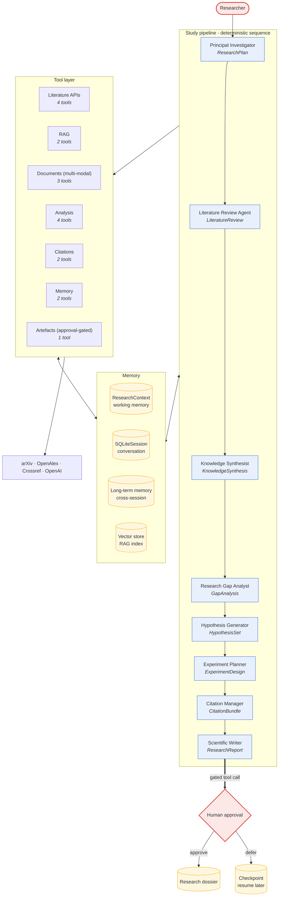

# Architecture Diagram

*Generated by `scripts/generate_diagram.py` from the live agent definitions, so
it cannot drift from the code.*

8 agents · 18 tools · 8 pipeline stages

## Reading the diagram

- **Solid arrows** are the deterministic pipeline: stage order is fixed in code
  because research stages have hard dependencies.
- **The `search_literature` tool** fans out across three databases concurrently -
  the one place with genuine parallelism.
- **The citation-integrity output guardrail** rejects any `paper_id` an agent
  cites that is not in the retrieved corpus - fabrication is blocked
  deterministically, not by a reviewer.
- **The red path** is the human-in-the-loop gate. Deferring checkpoints the run
  so the decision can be made in a different process, or a week later.

## Agent roster

| Agent | Structured output | Tools | Guardrails |
|---|---|---|---|
| Principal Investigator | `ResearchPlan` | 2 | research_question_guardrail |
| Literature Review Agent | `LiteratureReview` | 7 | — |
| Knowledge Synthesist | `KnowledgeSynthesis` | 3 | citation_integrity_guardrail |
| Research Gap Analyst | `GapAnalysis` | 3 | citation_integrity_guardrail |
| Hypothesis Generator | `HypothesisSet` | 3 | citation_integrity_guardrail |
| Experiment Planner | `ExperimentDesign` | 5 | — |
| Citation Manager | `CitationBundle` | 3 | citation_integrity_guardrail |
| Scientific Writer | `ResearchReport` | 6 | citation_integrity_guardrail |
